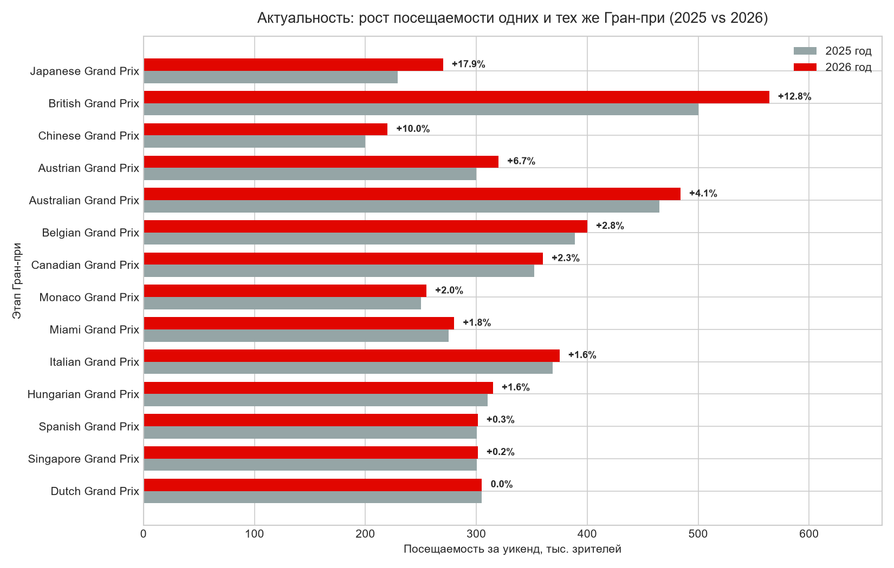
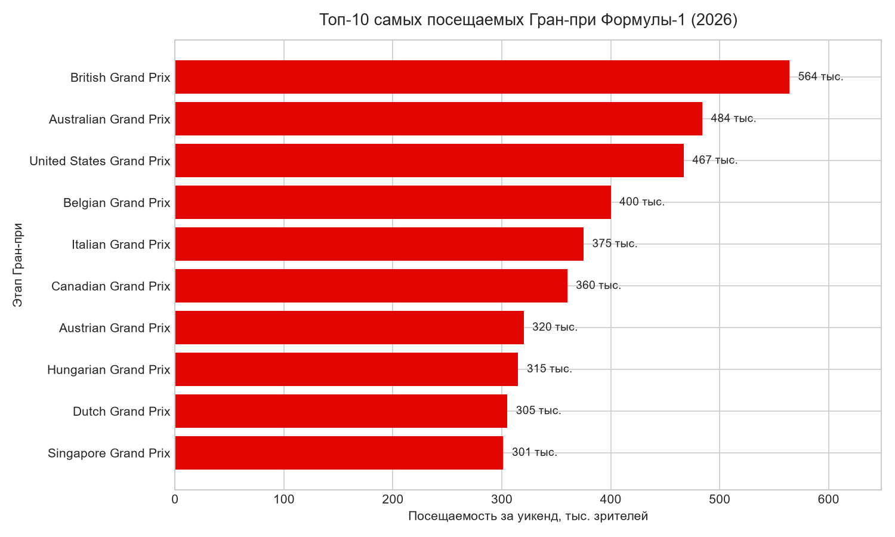
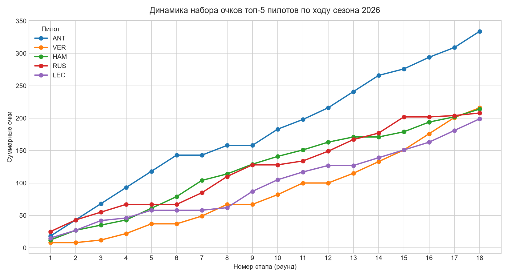
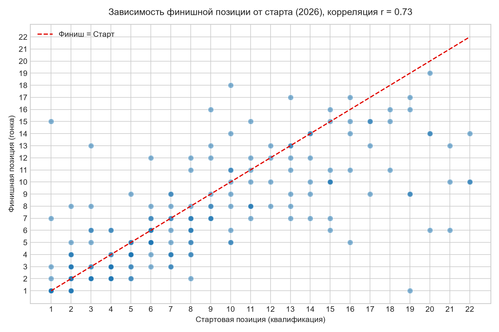
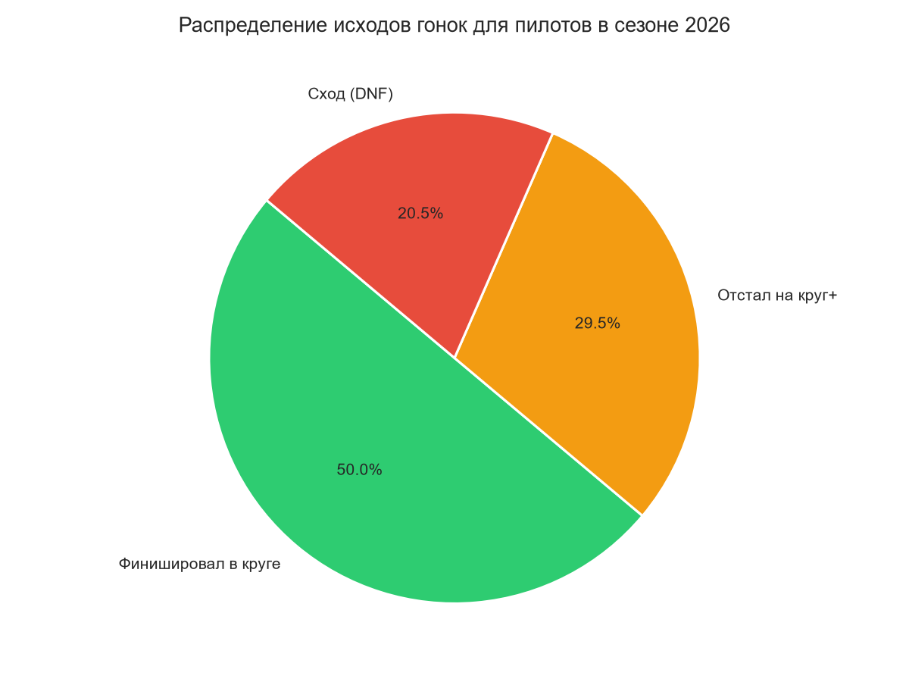
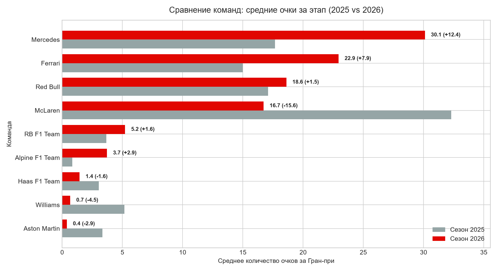

# Веб-сервис по аналитике Формулы-1

Данные для анализа и разработки проекта.

## Структура репозитория
* `f1_drivers_results.csv` — результаты гонок по всем пилотам и этапам (875 записей за сезоны 2025–2026)[cite: 2].
* `f1_audience.csv` — официальная статистика посещаемости автодромов и глобальной ТВ-аудитории (37 этапов)[cite: 2].
* `scripts/analyze_data.py` — Python-скрипт для обработки данных и генерации визуализаций.
* `charts/` — сгенерированные графики анализа данных.

---

## 1. Обоснование актуальности проекта (2025 vs 2026)

### Рост посещаемости на одних и тех же трассах

### Лидеры посещаемости среди этапов 2026 года

**Выводы по актуальности:**
* Сравнение 14 общих этапов двух сезонов показывает устойчивый рост аудитории без единого спада: на **13 из 14** трасс посещаемость выросла, на 1 осталась на прежнем уровне (Нидерланды — 305 тыс.).
* Суммарная посещаемость этих 14 этапов увеличилась с **4.54 млн** до **4.75 млн** человек (**+4.5%**), а средняя посещаемость по всем этапам сезона выросла на **10.7%** — с 298 тыс. до **330 тыс.** зрителей за уикенд.
* Главные драйверы роста: Гран-при Японии (**+17.9%**), Великобритании (**+12.8%**, рекордные 564 тыс. зрителей) и Китая (**+10.0%**).
* Средняя глобальная телеаудитория одного Гран-при выросла на **5.1%** — с 76.1 млн до **80.0 млн** зрителей на гонку.
* **Продуктовый итог:** растущий рынок и миллионная аудитория напрямую подтверждают востребованность специализированного веб-сервиса с удобной статистикой и аналитикой гонок.

---

## 2. Спортивная аналитика и проектирование фич сервиса

### Динамика борьбы за титул (сезон 2026)

**Вывод:** После 18 этапов лидирует Кими Антонелли (334 очка), а за 2–5 места идет плотная борьба между Ферстаппеном (216), Хэмилтоном (214), Расселлом (208) и Леклером (199). Обычная турнирная таблица показывает только итоговую сумму, поэтому **интерактивный график прогресса пилотов и команд по этапам** станет одним из базовых модулей сервиса.

---

### Влияние квалификации на финишную позицию

**Вывод:** Между стартовой и финишной позициями выявлена сильная положительная корреляция (**r = 0.73**). Точки ниже красной пунктирной линии отражают прорывы в гонке, выше — потерю позиций. Эта закономерность ляжет в основу **модуля оценки важности квалификации на разных трассах и прогнозирования исходов гонок**.

---

### Надежность болидов и распределение исходов гонок

**Вывод:** В сезоне 2026 ровно половина стартов (**50.0%**) завершилась финишем в лидирующем круге, **29.5%** — с отставанием на один и более кругов, а **20.5%** (81 случай) — сходом с дистанции (DNF). Учет высокого процента сходов необходим в сервисе для **расчета индекса надежности команд и корректировки вероятностей в прогнозах**.

---

## 3. Сравнение сезонов 2025 и 2026

| Показатель | Сезон 2025 (24 этапа) | Сезон 2026 (18 этапов) | Изменение |
| :--- | :---: | :---: | :---: |
| Количество команд | 10 | 11 | +1 команда |
| Доля сходов (DNF) | 12.5% | 20.5% | +8.0 п.п. |
| Корреляция старт–финиш (r) | 0.75 | 0.73 | -0.02 |
| Средняя посещаемость этапа | 298 тыс. | 330 тыс. | +10.7% |
| Средняя ТВ-аудитория этапа | 76.1 млн | 80.0 млн | +5.1% |

**Вывод:** Смена технического регламента в 2026 году привела к резкому изменению баланса сил и росту непредсказуемости гонок:
* **Mercedes** (+12.4 очка за этап в среднем) и **Ferrari** (+7.9) вышли в лидеры, тогда как чемпион 2025 года **McLaren** потерял в темпе (-15.6 очка за этап).
* Доля сходов выросла с **12.5%** до **20.5%**, что повышает ценность актуальной аналитики надежности для болельщиков.

---

## Общий вывод
1. **Актуальность подтверждена данными:** посещаемость этапов (+10.7%) и телеаудитория (+5.1%) стабильно растут.
2. **Определен ключевой функционал веб-сервиса:** модуль сравнения сезонов, накопительные графики борьбы в чемпионате, оценка влияния квалификации на результат и трекер надежности команд.
